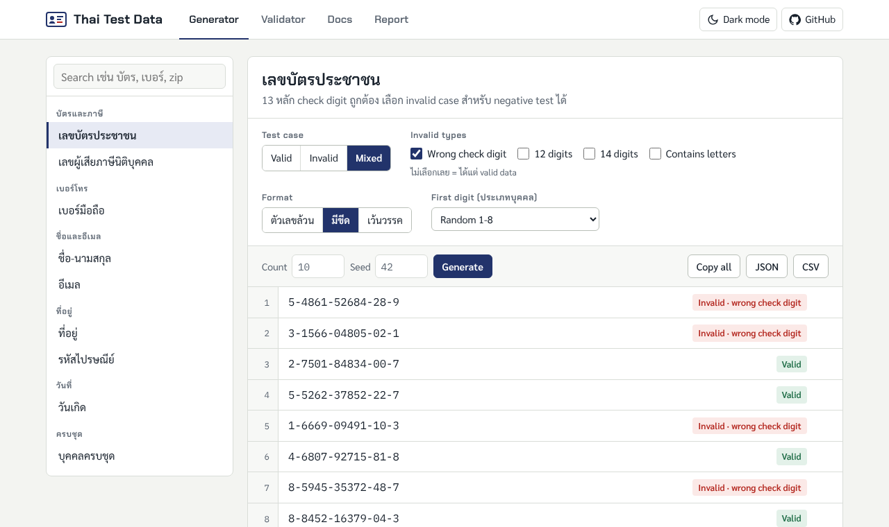

<div align="center">

# Thai Test Data

**สร้างข้อมูลทดสอบภาษาไทยที่ผ่าน validation จริง ทั้งกรณีถูกและกรณีผิด**<br>
Realistic, valid Thai test data for QA and test automation, with negative cases built in.

[](https://github.com/jodpacharapon/thai-test-data/actions/workflows/ci.yml)
[](LICENSE)


[**Web app**](https://thai-test-data.vercel.app) · [**Docs**](https://thai-test-data.vercel.app/#docs) · [Report a bug](https://thai-test-data.vercel.app/#report) · [Request a data type](https://github.com/jodpacharapon/thai-test-data/issues/new?template=feature_request.yml)



</div>

## Contents

- [Why](#why)
- [Features](#features)
- [Quick start](#quick-start)
- [Usage](#usage)
- [API Reference](#api-reference)
- [Project structure](#project-structure)
- [Development](#development)
- [Address data](#address-data)
- [Contributing](#contributing)
- [Disclaimer](#disclaimer)
- [License](#license)

## Why

ระบบไทยส่วนใหญ่ตรวจ check digit ของเลขบัตรประชาชน และตรวจว่ารหัสไปรษณีย์ตรงกับจังหวัดหรือไม่
ถ้ากรอก `1111111111111` หรือที่อยู่มั่วๆ form จะไม่ผ่าน tester เลยต้องเสียเวลาหา test data ที่ "ถูกพอ" มาใช้ทุกครั้ง

Thai Test Data generate ข้อมูลที่ผ่าน validation ได้ทันที และ generate **invalid data แบบตั้งใจ**ได้ด้วย
แต่ละค่ามี expected result บอกไว้ เอาไปเขียน negative test case ได้เลย

ใช้ได้ 2 แบบ:

| | For | How |
|---|---|---|
| 🌐 **Web app** | Manual / QA tester | เปิด [thai-test-data.vercel.app](https://thai-test-data.vercel.app) เลือก data type ตั้งค่า แล้ว copy หรือ export เป็น CSV/JSON |
| 📦 **Library** | Automation tester | `npm install thai-test-data` แล้วเรียกใช้ใน Playwright, Cypress, Jest หรือ Vitest |

## Features

- **เลขบัตรประชาชนและเลขนิติบุคคล** ที่ check digit ถูกต้อง กำหนดหลักแรก (ประเภทบุคคล 1–8) ได้
- **เบอร์มือถือ** ขึ้นต้น 06/08/09 มี format แบบมีขีดและ +66
- **ชื่อ-นามสกุล** ไทยและอังกฤษ มีคำนำหน้า เลือกเพศได้
- **ที่อยู่ครบ 77 จังหวัด 7,436 ตำบล** ที่จังหวัด อำเภอ ตำบล และรหัสไปรษณีย์ตรงกันจริง มี format ภาษาอังกฤษ
- **รหัสไปรษณีย์ 966 รหัส** พร้อม lookup ว่ารหัสเป็นของพื้นที่ไหน
- **วันเกิด** ตามช่วงอายุ format พ.ศ., แบบเต็ม หรือ ISO
- **Negative cases ทุก data type** เช่น check digit ผิด, ไม่ครบหลัก, มีตัวอักษรปน, รหัสไปรษณีย์ไม่ตรงจังหวัด, วันที่ 31/04
- **Seedable** ใส่ seed เดิมได้ข้อมูลชุดเดิม test fail แล้ว reproduce ได้
- **Zero dependencies** และเขียนด้วย TypeScript แบบ strict

## Quick start

```bash
npm install --save-dev thai-test-data
```

```ts
import { createThaiData, isValidThaiId } from "thai-test-data";

const td = createThaiData({ seed: 42 }); // seed เดิม → ข้อมูลเดิมทุกครั้ง

td.citizenId();            // "5486152684282"
td.phone();                // "0931566048"
td.address().fullAddress;  // "592/27 หมู่ 1 ถนนพหลโยธิน ตำบลสระพังทอง อำเภอเขาวง กาฬสินธุ์ 46160"
td.person();               // ชื่อ เลขบัตร เบอร์ อีเมล วันเกิด ที่อยู่ ของคนเดียวกัน

isValidThaiId("1-2345-67890-12-1"); // true
```

ต้องใช้ Node.js 20 ขึ้นไป package เป็น ES module

## Usage

### Playwright: positive และ negative test

```ts
import { test, expect } from "@playwright/test";
import { createThaiData } from "thai-test-data";

const td = createThaiData({ seed: 42 });

test("สมัครสมาชิกด้วยข้อมูลที่ถูกต้อง", async ({ page }) => {
  const user = td.person();
  await page.goto("/register");
  await page.fill("#citizenId", user.citizenId);
  await page.fill("#phone", user.phone);
  await page.fill("#address", user.address.fullAddress);
  await page.click("button[type=submit]");
  await expect(page.getByText("สมัครสำเร็จ")).toBeVisible();
});

for (const kind of ["checksum", "short", "long", "letters"] as const) {
  test(`ปฏิเสธเลขบัตรที่ผิดแบบ ${kind}`, async ({ page }) => {
    await page.goto("/register");
    await page.fill("#citizenId", td.invalidCitizenId(kind));
    await page.click("button[type=submit]");
    await expect(page.getByText("เลขบัตรประชาชนไม่ถูกต้อง")).toBeVisible();
  });
}
```

### เตรียม test data หลายรายการ

```ts
const users = td.many(100, () => td.person("female"));
const chiangMaiZips = td.many(20, () => td.postalCode({ province: "เชียงใหม่" }));
```

### Assert ข้อมูลที่ API ตอบกลับมา

```ts
import { isValidMobilePhone, lookupPostalCode } from "thai-test-data";

expect(isValidMobilePhone(response.phone)).toBe(true);
expect(lookupPostalCode(response.zip).map((l) => l.province)).toContain(response.province);
```

## API Reference

สร้าง generator ด้วย `createThaiData({ seed? })` แล้วเรียก method จาก instance ที่ได้ (ในตัวอย่างใช้ชื่อ `td`)

### Valid data

| Method | Returns |
|---|---|
| `td.citizenId(firstDigit?)` | เลขบัตรประชาชน 13 หลัก กำหนดหลักแรก 1–8 ได้ |
| `td.juristicId()` | เลขผู้เสียภาษีนิติบุคคล ขึ้นต้นด้วย 0 |
| `td.phone(prefixes?)` | เบอร์มือถือ 10 หลัก จำกัดเลขขึ้นต้นได้ เช่น `["08"]` |
| `td.name(gender?)` | ชื่อไทยและอังกฤษ พร้อมคำนำหน้า |
| `td.address(options?)` | ที่อยู่ กรองได้ด้วย `{ province }` หรือ `{ bangkok }` |
| `td.postalCode(options?)` | รหัสไปรษณีย์ที่มีใช้จริง กรองได้เหมือน `address` |
| `td.birthDate(minAge?, maxAge?)` | `Date` ของวันเกิดตามช่วงอายุ (default 18–65) |
| `td.person(gender?)` | ข้อมูลบุคคลครบชุด |
| `td.many(count, factory)` | เรียก `factory` ซ้ำ `count` ครั้ง แล้วคืนเป็น array |
| `td.random` | random function ที่ใช้ seed เดียวกัน สำหรับ generate ข้อมูลแบบของตัวเอง |

### Invalid data (negative cases)

| Method | `kind` (ตัวแรกคือ default) |
|---|---|
| `td.invalidCitizenId(kind?)` | `"checksum"`, `"short"` (12 หลัก), `"long"` (14 หลัก), `"letters"` |
| `td.invalidJuristicId(kind?)` | เหมือน `invalidCitizenId` |
| `td.invalidPhone(kind?)` | `"prefix"` (เช่น 02), `"short"`, `"long"`, `"letters"` |
| `td.invalidPostalCode(kind?)` | `"unknown"` (5 หลักแต่ไม่มีจริง), `"short"`, `"long"`, `"letters"` |

### Validators และ formatters

| Function | Description |
|---|---|
| `isValidThaiId(value)` | validate เลข 13 หลัก (ไม่สนขีดและช่องว่าง) |
| `thaiIdCheckDigit(first12)` | คำนวณ check digit จาก 12 หลักแรก |
| `formatThaiId(id)` | `1234567890121` → `1-2345-67890-12-1` |
| `isValidMobilePhone(value)` | validate เบอร์มือถือ 10 หลัก |
| `formatPhone(phone)` / `toE164(phone)` | `081-234-5678` / `+66812345678` |
| `isValidPostalCode(code)` | เช็กว่ารหัสไปรษณีย์มีใช้จริง |
| `lookupPostalCode(code)` | รายการตำบล อำเภอ จังหวัด ที่ใช้รหัสนี้ |
| `formatThaiDate(date)` / `formatThaiDateLong(date)` | `26/10/2569` / `26 ตุลาคม 2569` |
| `formatIsoDate(date)` | `2026-10-26` ตามเวลาท้องถิ่น |
| `toBuddhistYear(year)` / `toChristianYear(year)` | แปลง ค.ศ. ↔ พ.ศ. |
| `ageOn(birth, today?)` | อายุเต็มปี |

### Reference data

| Constant | Contains |
|---|---|
| `PROVINCES` | ชื่อจังหวัดไทยและอังกฤษ 77 จังหวัด |
| `LOCALITIES` | ตำบลทั้งหมด พร้อมอำเภอ จังหวัด และรหัสไปรษณีย์ |
| `POSTAL_CODES` | รหัสไปรษณีย์ที่มีใช้ทั้งหมด |

## Project structure

```
thai-test-data/
├── src/                     # library source
│   ├── index.ts             # createThaiData() และ export ทั้งหมด
│   ├── id.ts                # เลขบัตรประชาชน เลขนิติบุคคล check digit
│   ├── phone.ts             # เบอร์มือถือ
│   ├── name.ts              # ชื่อ-นามสกุล
│   ├── address.ts           # ที่อยู่
│   ├── postal.ts            # รหัสไปรษณีย์
│   ├── date.ts              # วันที่ พ.ศ.
│   ├── random.ts            # seeded random
│   └── data/localities.ts   # ข้อมูลตำบล (generated ห้ามแก้เอง)
├── test/                    # unit tests (Vitest)
├── site/index.html          # Web app (deploy บน Vercel)
├── scripts/                 # build script และ dev server
└── docs/                    # รูปใน README
```

## Development

```bash
git clone https://github.com/jodpacharapon/thai-test-data.git
cd thai-test-data
npm install
```

| Command | Description |
|---|---|
| `npm test` | run unit tests |
| `npm run typecheck` | type check |
| `npm run build` | build library ไปที่ `dist/` |
| `npm run site` | build library แล้ว copy ไปที่ `site/lib/` |
| `npm run dev` | build แล้ว serve web app ที่ http://localhost:8080 |

## Address data

ข้อมูลจังหวัด อำเภอ ตำบล และรหัสไปรษณีย์มาจาก
[kongvut/thai-province-data](https://github.com/kongvut/thai-province-data)
(MIT License, Copyright (c) 2025 Kongvut Sangkla) รายละเอียดอยู่ใน [THIRD_PARTY_NOTICES.md](THIRD_PARTY_NOTICES.md)

ข้อมูลผูกตำบลละ 1 รหัสไปรษณีย์ จึงอาจไม่มีรหัสเฉพาะของหน่วยงาน

Update เป็น version ใหม่:

```bash
git clone --depth 1 https://github.com/kongvut/thai-province-data /tmp/thai-province-data
npm run build:data -- /tmp/thai-province-data/api/latest/province_with_district_and_sub_district.json
```

แล้วแก้ `SOURCE_COMMIT` ใน [`scripts/build-localities.mjs`](scripts/build-localities.mjs) ให้ตรงกับ commit ที่ใช้

## Contributing

ยินดีรับทั้ง issue และ pull request ครับ อ่าน guideline ได้ที่ [CONTRIBUTING.md](CONTRIBUTING.md)
ดู release history ได้ที่ [CHANGELOG.md](CHANGELOG.md)

Roadmap ideas: เลขบัญชีธนาคาร, PromptPay, ทะเบียนรถ, เลขพาสปอร์ต, CLI, Python และ Robot Framework

## Disclaimer

<details>
<summary><b>English</b></summary>

- All data produced by this project is **synthetic** and randomly generated. It is not taken from any
  real person, database or government record. Names are common Thai names combined at random, and
  addresses use real localities that are not linked to any real household or person.
- Generated ID numbers pass the public check-digit formula but are **not issued by any authority**.
  A generated number may, by chance, match a number that belongs to a real person or company.
- Use this data **only for software testing and development**, in test or staging environments.
  Do not use it to register for real services, open accounts, create or alter identity documents,
  or impersonate anyone. Doing so may be a criminal offence in Thailand and in your own country.
- You are responsible for how you use this software and the data it produces, and for complying with
  the laws that apply to you. The software is provided "as is", without warranty of any kind, as stated
  in the [MIT License](LICENSE).

</details>

<details>
<summary><b>ภาษาไทย</b></summary>

- ข้อมูลทั้งหมดเป็น**ข้อมูลสังเคราะห์**ที่สุ่มขึ้น ไม่ได้นำมาจากบุคคล ฐานข้อมูล หรือทะเบียนราชการใด
  ชื่อเป็นชื่อไทยทั่วไปที่สุ่มจับคู่กัน ที่อยู่ใช้ชื่อพื้นที่จริงแต่ไม่ได้ผูกกับบ้านหรือบุคคลใด
- เลขที่สร้างผ่านสูตร check digit ที่เปิดเผยต่อสาธารณะ แต่**ไม่ได้ออกโดยหน่วยงานใด**
  และอาจบังเอิญตรงกับเลขของบุคคลหรือนิติบุคคลจริงได้
- ใช้เพื่อ**ทดสอบและพัฒนาซอฟต์แวร์เท่านั้น** ในระบบ test หรือ staging ห้ามนำไปสมัครบริการจริง เปิดบัญชี
  ทำหรือแก้ไขเอกสารแสดงตน หรือแอบอ้างเป็นผู้อื่น ซึ่งอาจเป็นความผิดทางอาญาทั้งในประเทศไทยและประเทศของผู้ใช้
- ผู้ใช้รับผิดชอบการใช้งานซอฟต์แวร์และข้อมูลที่ได้เอง รวมถึงการปฏิบัติตามกฎหมายที่เกี่ยวข้อง
  ซอฟต์แวร์นี้ให้ใช้ตามสภาพ ("as is") โดยไม่มีการรับประกันใดๆ ตาม [MIT License](LICENSE)

</details>

## License

[MIT](LICENSE) © jodpacharapon · ข้อมูลที่อยู่ © Kongvut Sangkla ([MIT](THIRD_PARTY_NOTICES.md))
